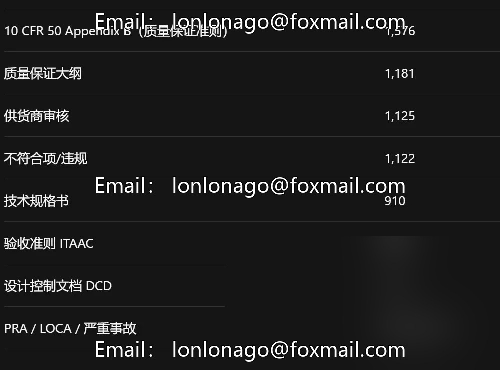

# Original regulatory documents of the American nuclear regulatory board

## Body

American Nuclear Regulatory Commission (NRC) original regulatory documents: 2,282 PDFs, 265,218 pages, 7.1 GB, spanning from 2000 to 2026, covering the full process from design certification to construction permit for five advanced light-water reactor models. All are original government files and can be cited page by page.
Price negotiation
Those interested may explore further; there may be surprises [fire]

The original regulatory documents of the US Nuclear Regulatory Commission are provided, including bargaining-related materials; the images list quality assurance, supplier review, non-conformance items, technical specifications and acceptance criteria.

<!-- AI_ENRICHED -->

## Images

## Payment

Here is a pay link on Stripe ( https://buy.stripe.com/3cs8yP7sY87d0vu9AB ). Please contact me lonlonago@foxmail.com after funding $89, and I will send you a complete data files , thank you!

